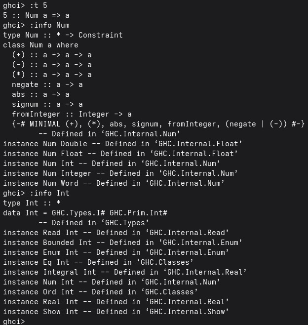

## Práctica 3: Mis tipos de datos y listas por compresión
* Alumno:Esquivel Cruz Santiago
* Semestre: 2027-1 

# Objetivo de la práctica 

El objetivo de esta práctica considero que es el escalón previo a la recursión e irse familiarizando con la entrega de tipos de listas, condiciones con ellas y la generación de las mismas.
Además de la implementación de tipos de datos generados por nosotros y la importación de funciones a través de modulos con la finalidad de eficientar operaciones algo complejas y tener una mejor organización en el mismo código. 

* Tiempo empleado en está práctica fue como de 5 a 6 horas, por un conflicto que tuve con un error en la terminal ocasionado por no cerrar correctamente ghci debido a que se había congelado y tuve otro despapaye aún más grande que el anterior pero se solucionó.

# ¿Cuál es la diferencia entre Num e Int?

Que haya entendido la diferencia entre Num e Int esque Int esta dentro de Num ya que Num es una clase donde puede ser un Int, Float, Double, etc, osea que el dominio de Num es más largo que el dominio de Int.

# Ejemplo en GHCi

